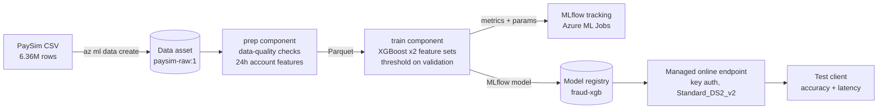

# Fraud Detection on Azure Machine Learning

The PaySim fraud model from my [Databricks Fraud Lakehouse](https://github.com/ChrishA-tech/fraud-lakehouse), rebuilt
on **Azure Machine Learning** end to end: a versioned **data asset**, a two-step **pipeline job** on a compute cluster
that scales to zero, **MLflow** tracking, the **model registry**, and a real-time **managed online endpoint** serving
the MLflow model without a scoring script. Same features, split and threshold rule as the Databricks version, so the
two platforms can be compared like for like.



## Results

<!-- RESULTS:START -->
Run on Azure ML (Azure for Students), pipeline job `strong_tail_zm5l4hwsvt`, model `fraud-xgb:2`.

Data: 6,362,620 raw rows, 2,770,409 TRANSFER/CASH_OUT rows modelled; time split train / validation / test = 1,951,895 / 410,437 / 408,077 (4,010 fraud cases in the test period, 16 days never used for training or the threshold).

| Model (held-out test period) | PR-AUC | ROC-AUC | Precision | Recall | False declines | Training time |
|---|---|---|---|---|---|---|
| XGBoost, all features | 0.9988 | 0.9990 | 0.997 | 0.999 | 14 | 7 s |
| XGBoost, without balance-error artefact (model served by the endpoint) | 0.9931 | 0.9998 | 0.908 | 0.997 | 403 | 34 s |

**Endpoint** (`Standard_DS2_v2`, managed online endpoint, MLflow model with no scoring script): 6/6 held-out test payments classified correctly (3 fraud, 3 genuine); latency over 50 requests of 6 rows: p50 107.9 ms, p95 120.9 ms (measured from the UK, including network). Deployment took about 19 minutes; the endpoint was deleted after testing.

**Data-quality checks:** has_account_ids 0, amount_valid 0, known_type 0, label_binary 0, step_in_month 0, balances_non_negative 0 failing rows.

PaySim is simulated: its balance fields reveal fraud almost perfectly, so treat these scores as an upper bound for real payments, not an estimate.
<!-- RESULTS:END -->

## What each part shows

| Skill | Where | What it does |
|---|---|---|
| Azure ML data assets | `scripts/01_upload_data.sh` | Uploads the raw CSV once as a versioned `uri_file` asset; the pipeline reads `paysim-raw:1` |
| Pipelines and components | `pipelines/train_pipeline.yml`, `components/*.yml` | Two reusable command components wired into a pipeline job; one conda environment built once and cached |
| Data quality | `src/features.py` | The Lakeflow expectations rewritten in pandas: critical failures dropped, warnings counted and logged |
| Feature engineering | `src/features.py` (`dest_window_24h`) | Receiving-account activity in the previous 24 hours, vectorised with one cumulative sum (no future leakage); tested against a slow reference loop |
| Modelling and evaluation | `src/train.py` | Time-based train/validation/test split, XGBoost with class weighting and early stopping, decision threshold chosen on validation to maximise net savings, PR-AUC/precision/recall on a later, unseen period |
| MLflow and model registry | `src/train.py`, `scripts/02_train.sh` | Params and metrics logged to the Azure ML job; the model saved as an MLflow pyfunc and registered as `fraud-xgb` |
| Deployment | `deploy/*.yml`, `scripts/03_deploy.sh` | Managed online endpoint with key auth; no-code MLflow deployment that returns a probability and a decline decision |
| Testing the endpoint | `scripts/04_test_endpoint.py` | Checks answers on held-out fraud and genuine payments and times 50 requests (p50/p95) |
| Cost control | `config.env`, `scripts/05_cleanup.sh` | Cluster with 0 minimum nodes; the endpoint is deleted after testing; one command removes everything |
| Local tests | `tests/test_local.py` | Feature maths, data-quality rules, and prep -> train -> load MLflow model -> score, before any cloud spend |

## Run it

Needs an Azure subscription; **Azure for Students** works (university email, no card), plus the PaySim CSV from
[Kaggle](https://www.kaggle.com/datasets/ealaxi/paysim1) and the Azure CLI (`brew install azure-cli`).

```bash
bash scripts/00_setup.sh          # sign in, workspace, compute cluster (scales to zero)
bash scripts/01_upload_data.sh    # data asset from ~/Downloads/PS_20174392719_1491204439457_log.csv
bash scripts/02_train.sh 0.1      # optional quick check on 10% of rows
bash scripts/02_train.sh          # full run: pipeline job, metrics, model registration
bash scripts/03_deploy.sh         # endpoint, test calls, then deletes the endpoint
python3 scripts/update_readme.py  # write the real results into this README
bash scripts/05_cleanup.sh --everything   # remove the resource group when finished
```

Local tests: `pip install -r requirements-dev.txt && pytest -q`.

**Cost.** The cluster bills only while a job runs and the endpoint only while it exists. The scripts delete the endpoint
straight after testing. Check spend in the Azure portal under Cost Management.

**If a step fails:** a region error at setup means the subscription does not allow that region (change `LOCATION` in
`config.env`); a job stuck in *Queued* means there is no vCPU quota for that VM size (change `TRAIN_VM`, or request quota
in ml.azure.com -> Quota).

## Notes

- PaySim is a simulator. Its balance fields give fraud away almost completely, so the model is also trained and
  deployed without the two balance-error features; even then, scores are an upper bound for real payment data.
- The GBP cost of a false decline (£10) is an illustrative assumption, used only to choose the threshold.
